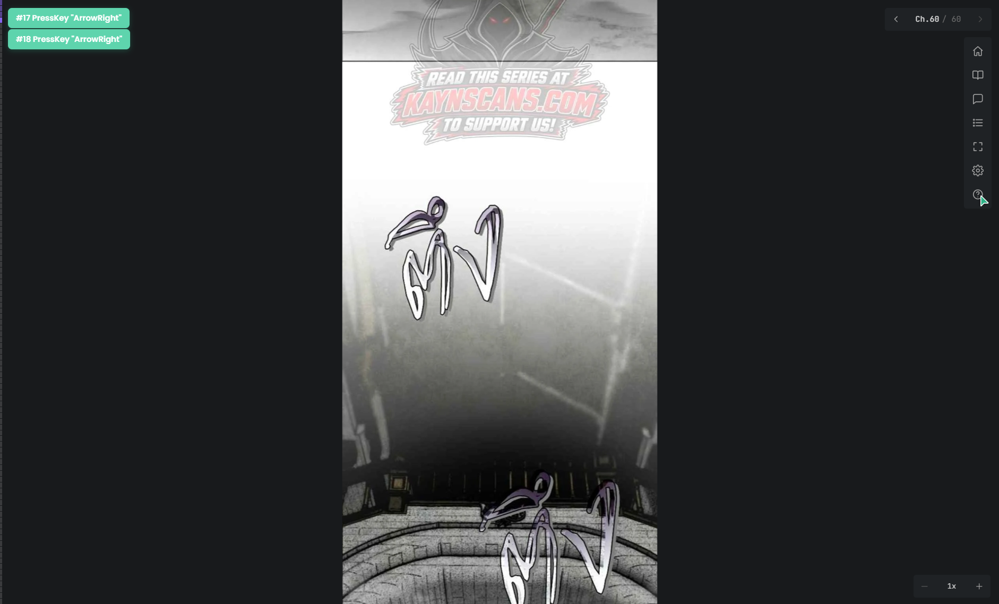
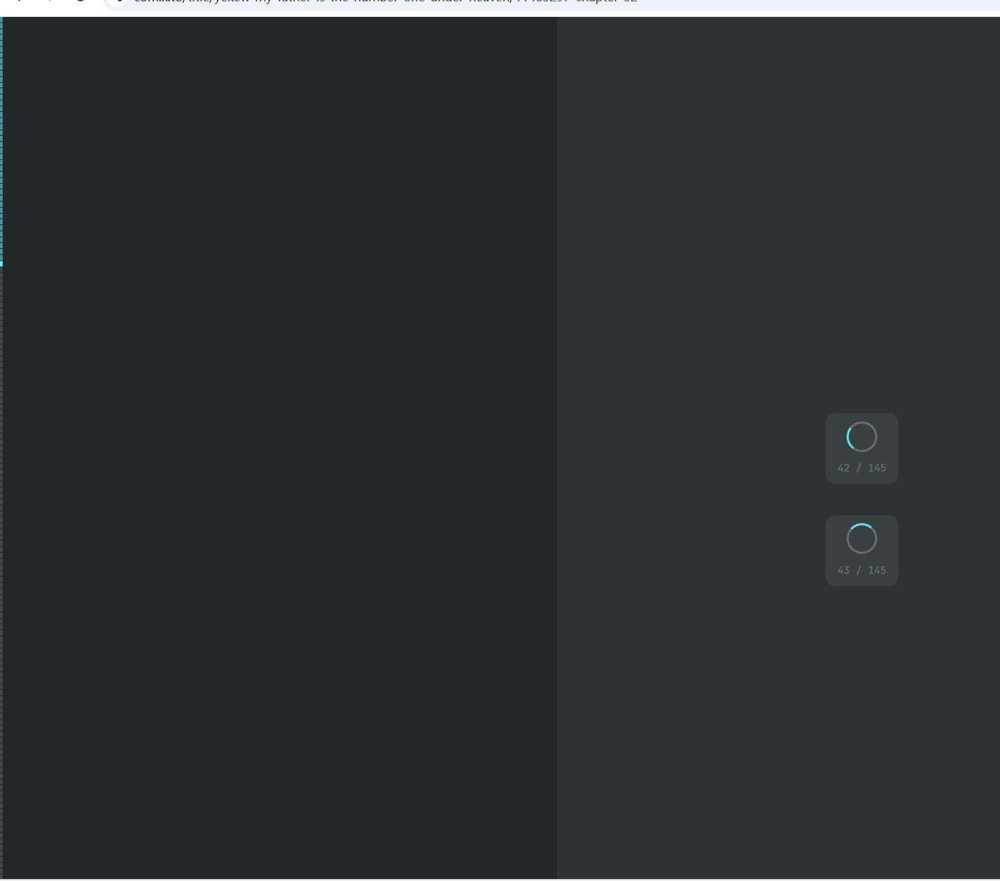
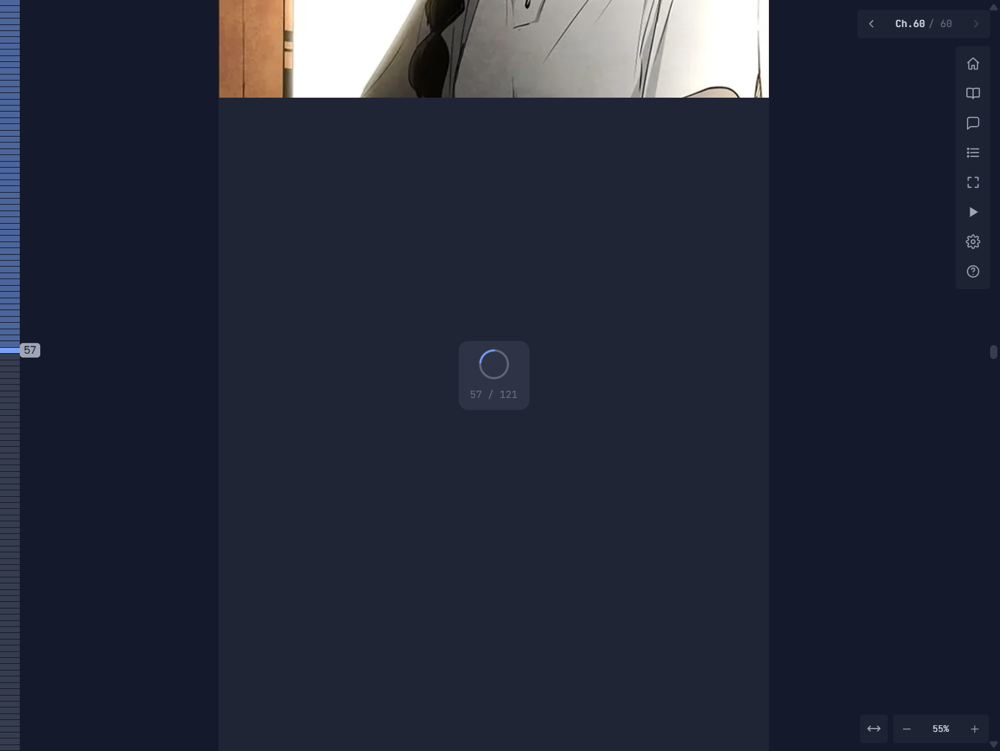
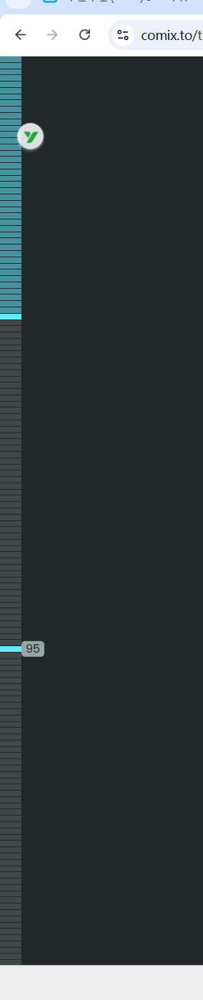
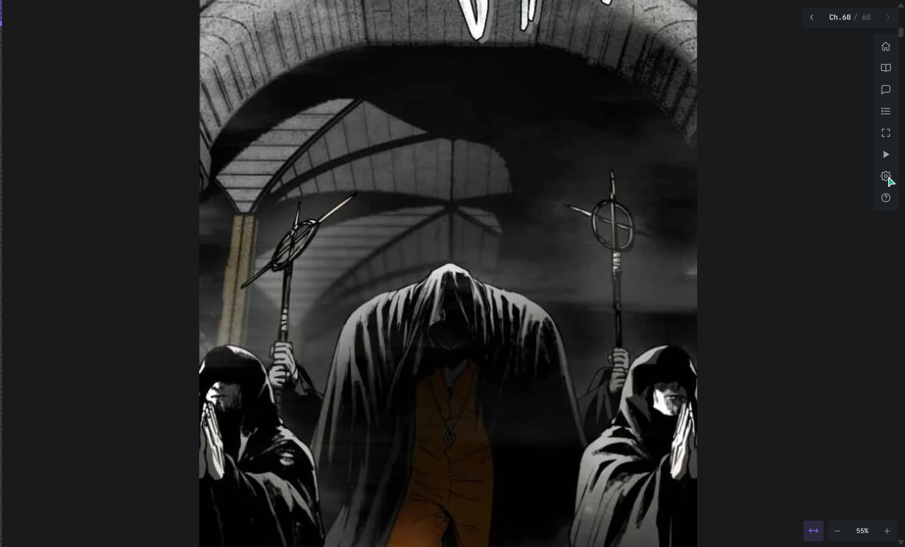
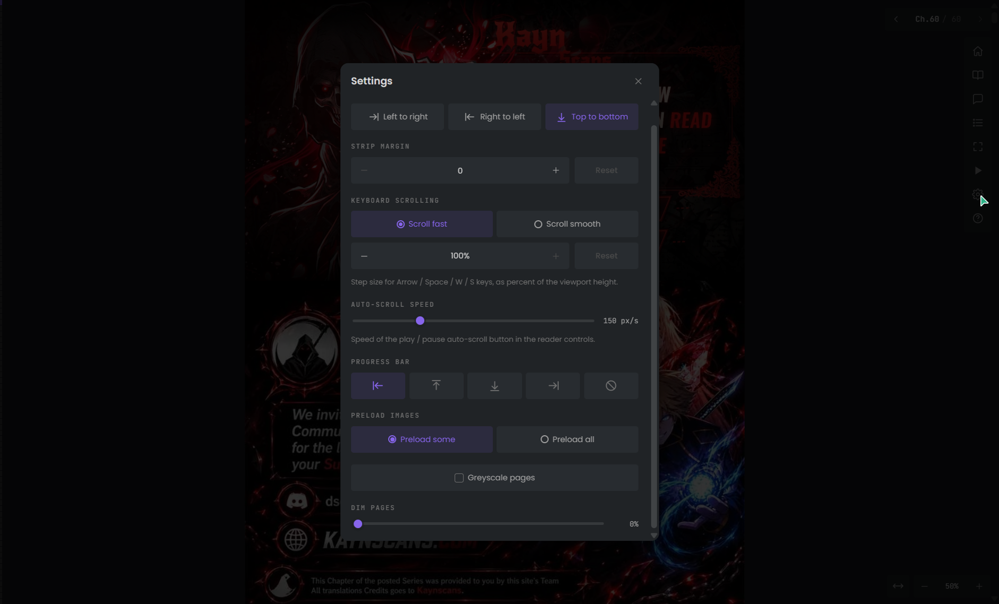
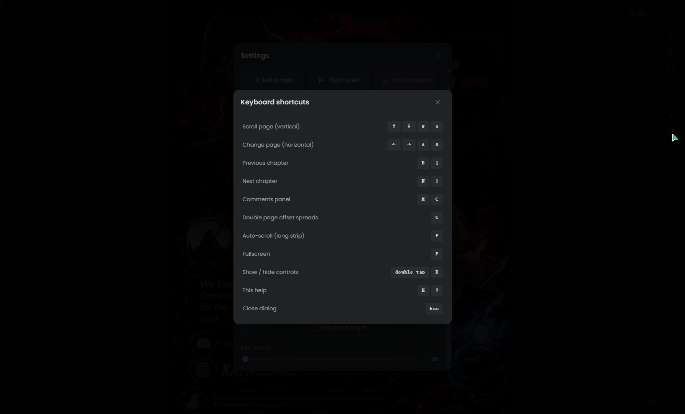
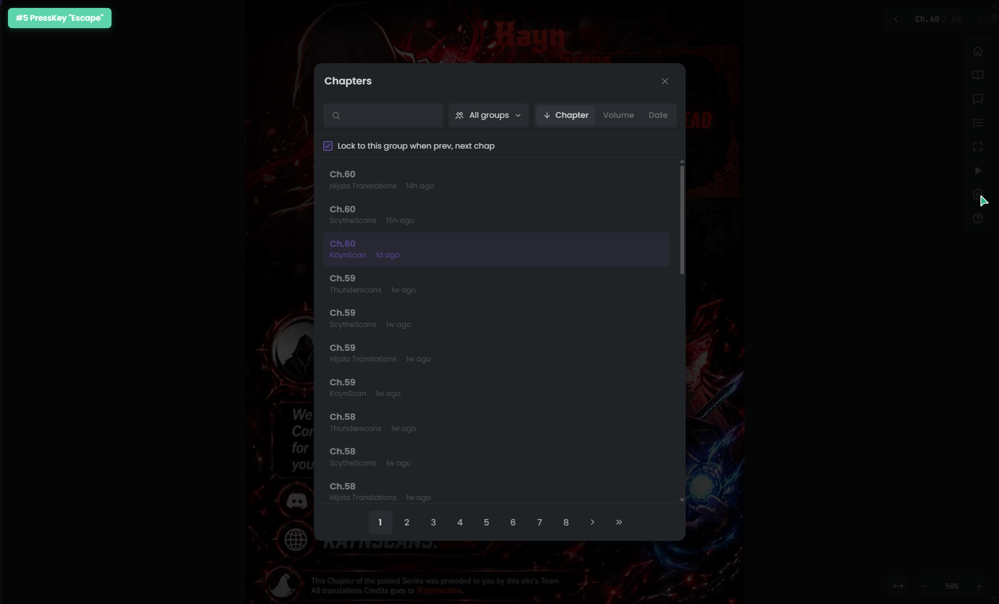
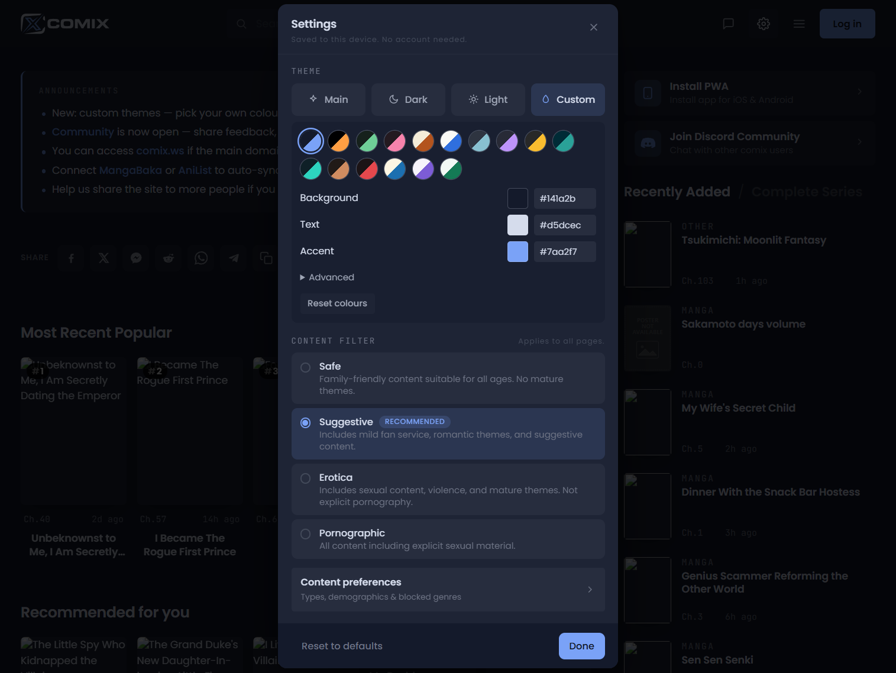
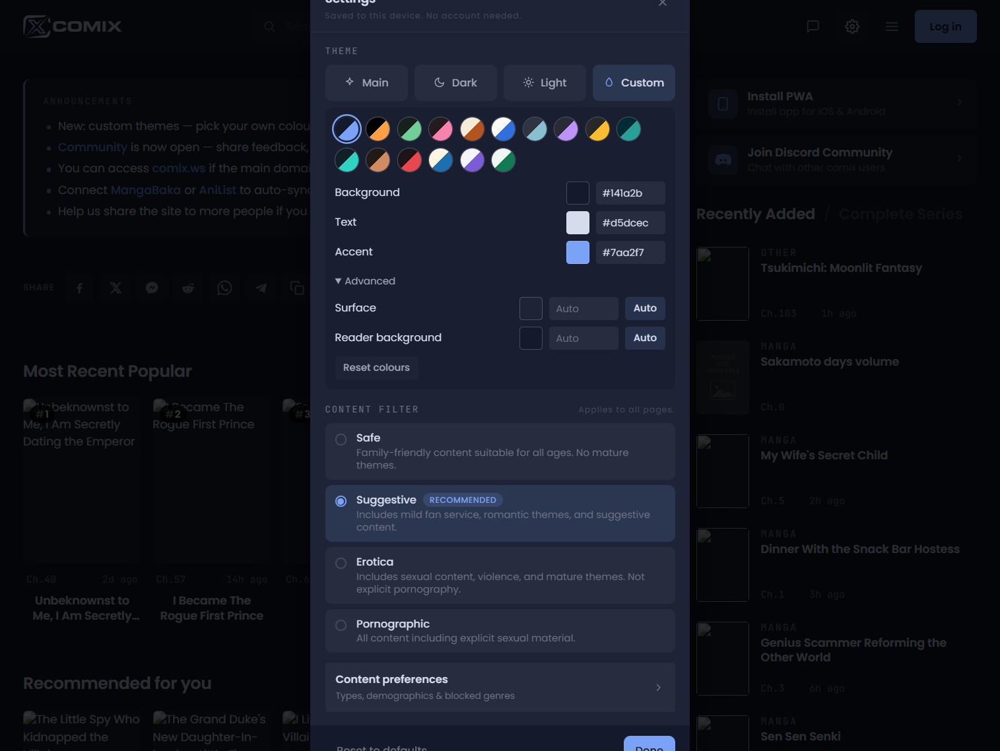

# comix.to × mangrove 漫画阅读器对比分析（视觉规格版）

> **调研日期**：2026-10-14
> **调研方式**：Trae 内置浏览器实地操作 + DOM/CSSOM 计算样式提取 + 样式表规则读取（非仅凭截图目测）
> **调研对象**：
> - **comix.to**：Web 阅读器（长卷滚动 / 分页两种模式），作品《Fog Land》Ch.60 的两个翻译组版本（104 页 / 121 页）、《Gachiakuta》Ch.165；桌面 Chromium，视口 1506×910 与 1212×910
> - **mangrove**：Flutter 桌面端阅读器（阅读素材 / 成品 / 网络漫画三类读者共用同一套阅读器），代码版本为本地工作区 `D:\AI Coding Project Management\Mangrove\Mangrove`
> **范围**：仅阅读消费侧（阅读器布局、控件、设置、章节列表、评论、章尾）。**不含翻译工作室 / 翻译管线**（扫描、OCR、译文叠加等）。
> **术语**：全文使用"翻译组"（comix.to 为外文站点，内容为英/韩/日文漫画的英译等，"汉化组"措辞不符合实际）。

---

## 目录

1. [调研环境与截图索引](#1-调研环境与截图索引)
2. [设计 Token 总表](#2-设计-token-总表)
3. [整体布局与版面栅格](#3-整体布局与版面栅格)
4. [左侧页轨专项（重点）](#4-左侧页轨专项重点)
5. [右上：章节切换胶囊](#5-右上章节切换胶囊)
6. [右侧：竖向工具栏](#6-右侧竖向工具栏)
7. [右下：缩放控制簇](#7-右下缩放控制簇)
8. [阅读设置面板逐项对照](#8-阅读设置面板逐项对照)
9. [快捷键与手势对照](#9-快捷键与手势对照)
10. [章节列表面板对照](#10-章节列表面板对照)
11. [评论形态对照](#11-评论形态对照)
12. [章尾区域对照](#12-章尾区域对照)
13. [主题（配色）机制对照](#13-主题配色机制对照)
14. [mangrove 独有能力清单（防倒退）](#14-mangrove-独有能力清单防倒退)
15. [差距总表（价值 × 成本 × 分期建议）](#15-差距总表价值--成本--分期建议)

---

## 1. 调研环境与截图索引

| 编号 | 文件 | 内容 |
|---|---|---|
| 图 1 | `comix-reader-assets/01-reader-longstrip-default.png` | comix 默认长卷界面（1506px 视口，默认主题） |
| 图 2 | `comix-reader-assets/02-page-rail-expanded.png` | 左轨悬停展开 + 页码气泡 + 懒加载占位卡同框 |
| 图 3/4 | `03-reader-settings.png` / `04-reader-settings-bottom.png` | 阅读设置弹窗（上半 / 下半） |
| 图 5 | `05-keyboard-help.png` | 快捷键帮助弹窗 |
| 图 6 | `06-chapter-list.png` | 章节列表弹窗 |
| 图 7 | `07-comments-drawer.png` | 评论右侧抽屉 |
| 图 8 | `08-chapter-end.png` | 章尾：点赞卡 + 上下话导航 + 分享 |
| 图 9 | `09-paged-mode.png` | 分页（single）模式 |
| 图 10 | `10-zoom-fit-width.png` | 适应宽度开启状态 |
| 图 11/12 | `11-theme-custom.png` / `12-theme-advanced.png` | 站点自定义主题面板（预设 / Advanced） |
| 图 13 | `13-mid-strip.png` | 长卷中段阅读状态 |
| 用户图 1/2 | `user-1-rail-collapsed.png` / `user-2-rail-expanded.png` | 用户提供的页轨收起 / 展开特写 |

---

## 2. 设计 Token 总表

### 2.1 颜色

#### comix.to（硬编码 CSS 变量，暗色为默认）

| Token | 色值 | 用途 |
|---|---|---|
| `--bg` | `#181A1C`（rgb 24,26,28） | 阅读器 / 全站底色 |
| `--surface` | `#202326`（rgb 32,35,38） | 面板、弹窗底 |
| 按钮底 | `#282C30`（rgb 40,44,48） | 点赞卡、次级按钮 |
| `--accent` | `#8765EB`（rgb 135,101,235，紫） | 主强调色（当前页、已读、选中、主按钮） |
| `--accent-rgb` | `135 101 235` | 强调色透明派生（已读轨道 `.55`） |
| `--text` / `--text-rgb` | `#D4D4D4`（212,212,212） | 正文 |
| `--text-2` | `#A0A0A0`（160,160,160） | 次要文字、图标、页码气泡底 |
| 未读轨道 | `rgba(212,212,212,.18)` | 页轨未读格 |
| 禁用 | `#4A4A4A`（74,74,74） | 末话 › 等禁用态 |
| 浮层底 | `rgba(32,35,38,.92)` | 章节胶囊半透明底 |
| 分享钮底 | `rgba(212,212,212,.06)` | 圆形分享钮 |

> **注**：comix 调研当日正在上线新版自定义主题系统。阅读器内 Main 主题实测强调色为紫 `#8765EB`；站点外壳在重置 Main 后出现过青色 `#66E8FA`（用户截图中的青色即当时生效的主题色）。主题系统以 CSS 变量驱动，换色即时全站生效。详见[第 13 章](#13-主题配色机制对照)。

#### mangrove（Material 3 动态派生，非硬编码）

mangrove 没有阅读器级硬色板，颜色来自 `ThemeData.colorScheme`，由种子色经 `SeedColorScheme.fromSeeds(... FlexTones.vividBackground(brightness))`（[main.dart](file:///D:/AI%20Coding%20Project%20Management/Mangrove/Mangrove/lib/main.dart#L202-L252)）按明/暗自动派生。下表为**角色 Token**而非固定值：

| Token 角色 | 典型用途（阅读器） | 来源 |
|---|---|---|
| `colorScheme.surface` @ α 0.92 | 顶/底栏毛玻璃底色 | [scaffold.dart:379](file:///D:/AI%20Coding%20Project%20Management/Mangrove/Mangrove/lib/pages/reader/scaffold.dart#L375-L380) |
| `colorScheme.primary` | 滑条、章节列表当前话高亮（4px 左边框）、强调控件 | 主题种子色 |
| `colorScheme.primaryContainer` | 右下角浮动换章钮底 | 主题派生 |
| `colorScheme.tertiaryContainer` | 页码胶囊底 | 主题派生 |
| `IconButton.filledTonal` | 底栏上一章/下一章 | `secondaryContainer` 派生 |
| `colorScheme.onSurfaceVariant` | 次级图标/文字 | 主题派生 |
| 阅读背景（独立设置） | white / gray / black / sepia / green / system | 设置键 `readerBackgroundColor` |
| 夜间遮罩（独立设置） | warm / black / red，强度 0.1–0.85 | 设置键 `readerNightMode*` |

**差异**：comix 是"暗色优先的固定暗色体系 + 一套变量"；mangrove 是"明暗双套 + 种子色自动派生"，颜色随主题方案变化，规格随方案而非固定。

### 2.2 字号 / 字体 / 圆角 / 尺寸

| 维度 | comix.to | mangrove |
|---|---|---|
| 字体 | Poppins（UI）、JetBrains Mono（数字/等宽场景） | Noto Sans CJK + 系统回退（桌面端，[main.dart:210](file:///D:/AI%20Coding%20Project%20Management/Mangrove/Mangrove/lib/main.dart#L208-L222)） |
| 弹窗圆角 | 12px | M3 对话框默认（约 28）/ 边栏直角 |
| 卡片圆角 | 8px | 8px（页码胶囊）/ 16px（FAB、小卡） |
| 小控件圆角 | 4px（胶囊、气泡） | M3 全形/8–16 |
| 图标钮尺寸 | 34×34，透明底线性图标，图标色 `#A0A0A0` | 40–48 触控目标，IconButton（filledTonal/普通） |
| 顶栏高 | 无固定通栏（控件浮动，胶囊高 34） | **56**（`kTopBarHeight`） |
| 底栏高 | 无（右侧竖栏 + 右下缩放浮动） | **105**（双行）/ 紧凑态 56（`kBottomBarHeight`） |
| 图间间距 | 长卷 0（Strip margin 可调） | 默认 0，设置键 `readerPageSpacing` 0–50 |

---

## 3. 整体布局与版面栅格

### 3.1 comix 长卷模式（默认）


*图 1：默认长卷界面（1506×910 视口）*

结构（实测 DOM 与计算样式）：

```
┌─┬───────────────────────────────────────────────┬──┐
│ │  (顶栏无通栏)                              ◄Ch.60/60►│← 章节胶囊：右上浮动，高34
│ │                                            ┌──┐│
│ │              图片列 753px                    │家││← 右侧竖工具栏：
│ │         （flex 居中，页间 0 间距）             └──┘│  8×34px，间距36，
│2│                                            ┌──┐│  透明底，x≈1466
│4│  ← 左缘页轨                                 │书││
│p│    宽 24px                                  └──┘│
│x│  z-index:40                                ⋮  │
│ │            【N / 104 透明占位，懒加载】        ┌──┐│
│ │                                            │设││
│ │                                            └──┘│
│ │                                            ┌──┐│
│ │                                            │？││
│ │                                            └──┘│
│ │                              [⇔] [−] 55% [+] ← 右下缩放簇
└─┴───────────────────────────────────────────────┴──┘
  ↑ 阅读区底色 #181A1C；main 自身滚动，body overflow:hidden
```

- `main.rpage-main--long-strip`：flex column + `align-items:center`，自身为滚动容器；图片列实测宽 **753px**（缩放 50% 档；适应宽度时扩展到 828px，图 10）。
- 图片：零间距、无圆角、逐张懒加载；未进入视口的页渲染为透明占位，居中标注 `N / 总页数`（14px、`#D4D4D4`）；加载中为 spinner + 同样数字的圆角卡（图 2 中央，约 64×72、圆角 12、`rgba(40,44,48,…)` 底）。
- 所有 UI 控件**浮动**在画面上，没有实体通栏，遮挡最小。

### 3.2 comix 分页模式（rpage-main--single）



*图 9：分页模式，单页整高居中*

- 单页按**整高**渲染（实测 474×910），水平居中，两侧露底色；非滚动容器，左右键/点击翻页，右下缩放簇变为 `1x` 档位。
- 无跨页双拼（双页偏移由快捷键 G 提供）。

### 3.3 mangrove 对应布局

```
┌──────────────────────────────────────────────────┐
│ ←  书名（s18）/ 书名+话名(s16/s12)    💬 ⇄ ⋮ ⚙ │ ← 顶栏 56，毛玻璃 surface.92
├──────────────────────────────────────────────────┤
│                                                    │
│              PhotoView 图片区（全屏）                 │
│   gallery：PageView 整高/整宽；continuous：Sliver    │
│   E1 : P7                          ┌──────────┐    │
│   （左下描边页码）                    │   58×58   │    │ ← FAB primaryContainer
│                                     └──────────┘    │   圆角16（非无缝态换章）
├──────────────────────────────────────────────────┤
│ ⏮  ──────────●──────────────  [E1:P7]  ⏭       │ ← 底栏第一行
│ 🌙 ♥ 🔄 📖 💾 …（6 个功能钮）                      │ ← 底栏第二行（共高105）
└──────────────────────────────────────────────────┘
```

- 顶/底栏为实体毛玻璃条，点画面中央 `AnimatedSlide` 整体滑出/滑入。
- continuous 模式支持**无缝跨章**（中心锚定 CustomScrollView，章间为全屏接续卡，非翻页）；非无缝态支持越界拖出换章 + 边缘提示 + 右下 FAB。

**布局哲学差异**：comix = 极简浮动控件 + 边缘页轨，画面优先；mangrove = 标准双栏（顶/底）+ 高密度功能入口，功能优先。

---

## 4. 左侧页轨专项（重点）

这是用户最关注的组件。comix 的页轨同时承担"全局进度感 + 跳页"两个职能；mangrove 目前只有底部滑条。

### 4.1 comix 收起态规格（默认即此态）

| 项 | 规格 |
|---|---|
| 容器 | `.rpage-progress.rpage-progress--left`，`position:absolute; left:0; top:var(--rpage-header-h); bottom:0`；控件全隐时 `top:0`（0.25s 过渡） |
| 尺寸 | 宽 **24px**（1.5rem），高 = 阅读区全高；`z-index:40`；背景透明；flex column |
| 单元 | 每页 1 个 `<button class="rpage-progress__seg">`，`flex:1 1 0` **平分高度**；收起态 **3px 宽 × ≈8px 高** |
| 分隔 | 格间 `border-bottom:1px solid var(--bg)`（用阅读底色刻出 1px 分隔线，末格无线） |
| 无障碍 | `aria-label="Go to page N"`、原生 `title="Page N"`；页码由 CSS counter 自动编号 |
| 位置 | left/top/right/bottom/none 五选（阅读器设置，见 8.7） |



*用户图 1：收起态——左缘 24px 轨，已读区实心填色，未读为细密灰条*

### 4.2 三态色值（实测计算样式）

| 状态 | 类名 | 色值 | 尺寸 |
|---|---|---|---|
| 未读 | （无） | `rgba(212,212,212,.18)` | 3×8 |
| 已读 | `.is-visited` | `rgb(135 101 235 / .55)` | 3×8 |
| 当前页 | `.is-active` | `var(--accent)` = `#8765EB` 实心 | 3×8 |

（在用户截图的青色主题下三态同构替换为青色系：已读青 55%、当前亮青实心、未读灰 18%。）

### 4.3 悬停展开机制（纯 CSS，无 JS 动画）

从站点打包 CSS 直接提取的规则：

```css
/* 轨区域 hover：所有格 0.18s 内 3px → 24px */
.rpage-progress--left:hover .rpage-progress__seg { width: 1.5rem; }
/* 单格 hover：自身变实心强调色 */
.rpage-progress__seg:hover { background: var(--accent); }
/* 过渡属性 */
.rpage-progress__seg { transition: background .12s, height .18s, width .18s; }
```



*图 2：轨展开为 24px 宽横条；第 57 页为当前页（实心）；同框可见懒加载占位卡（spinner + 57/121）*



*用户图 2：展开态 + 当前页右侧的页码气泡「95」*

交互要点：
- 鼠标只要进入左缘 24px 热轨即整体展开，**不需要精确瞄准小格**；
- 离开轨区 0.18s 收回；
- 点击任意格 = `Go to page N`（长卷滚动到该页，分页模式直接跳页）。

### 4.4 页码气泡（CSS 伪元素，非 JS 弹层）

```css
.rpage-progress__seg::before {
  content: counter(span-counter);
  background: var(--text-2);   /* #A0A0A0 灰底 */
  color: var(--bg);           /* #181A1C 深字 */
  border-radius: .25rem;      /* 4px */
  padding: 0 .3rem;
  font-size: .8rem; line-height: 1.4;   /* ≈12.8px */
  opacity: 0; transition: .2s;
  position: absolute;
}
.rpage-progress--left .rpage-progress__seg:hover::before {
  opacity: 1; left: 100%;     /* 气泡出现在轨道右侧，垂直居中 */
}
```

### 4.5 懒加载占位卡（非页轨预览窗）

用户图 1 中 spinner +「42 / 145」的圆角卡，是**图片列自身的未加载页占位组件**（图 2 中央 57/121 同物），恰与页轨相邻出现，并非"轨悬停缩略预览"。comix 页轨只有页码气泡，没有缩略图预览。

### 4.6 用户截图中"白圆绿勾钮"核查

该元素在阅读器 DOM 中**不存在**（当前话全部 button/锚点已枚举），且白底细实色对勾的样式与 comix 暗色线性语言不符，判定为**浏览器扩展等外部悬浮元素**，不属于站点阅读器。

### 4.7 mangrove 现状

| 组件 | 规格 | 位置/代码 |
|---|---|---|
| 底部滑条 | `CustomSlider`，与上一章/下一章 `IconButton.filledTonal` 同行 | [scaffold.dart](file:///D:/AI%20Coding%20Project%20Management/Mangrove/Mangrove/lib/pages/reader/scaffold.dart) 底栏第一行 |
| 页码胶囊 | `tertiaryContainer` 底、圆角 8、高 **32**，文本 **`E{话} : P{页}`**（如 E1 : P7）；点击弹跳转输入框 | scaffold.dart:796, 910-914 |
| 左下页码 | 描边文字 `{话名} : {页}/{总页}`，可在设置关闭 | scaffold.dart:1037-1040 |
| 右下浮动换章钮 | **58×58**、圆角 **16**、`primaryContainer`，非无缝模式边缘越界时出现 | scaffold.dart:1323-1355 |
| 边缘页轨 | **无** | — |

### 4.8 对照小结

| 能力 | comix | mangrove |
|---|---|---|
| 进度信息密度 | 一眼看到已读/当前/未读的**全书位置分布** | 仅当前页/总页两个数字 |
| 跳页方式 | 点轨中任意位置（空间记忆，肌肉操作） | 拖滑条 / 点胶囊输页码 |
| 悬停反馈 | 轨展开 + 页码气泡（桌面原生体验） | 无 |
| 占位 | 不占通栏，视觉干扰 ≈0 | 底栏 105px（功能多但占地大） |
| 连续/分页 | 均适用 | 滑条均适用 |

---

## 5. 右上：章节切换胶囊


| 项 | comix 规格 |
|---|---|
| 形态 | 连体胶囊：`‹` 34×34 ＋「Ch.60 / 60」章节列表钮 ＋ `›` 34×34 |
| 尺寸 | 高 **34**、圆角 **4**、底 `rgba(32,35,38,.92)` |
| 文本 | 当前话白色，`/ 总数` 灰色；中间区域点击打开章节列表弹窗 |
| 禁用态 | 末话 `›` 为 `#4A4A4A` 不可点（图 1 即是末话） |
| 位置 | fixed 右上，竖工具栏上方 |

**mangrove 对应**：无上一章/下一章胶囊；换章入口是底栏两端的首章/末章样式 IconButton（`first_page` / `last_page` 图标）+ 右下 FAB；话名在顶栏中央。comix 的"当前话/总数"连体表达更紧凑直观。

---

## 6. 右侧：竖向工具栏

固定在右上（x≈1466，胶囊下方），`role=toolbar`，透明底，**8 个 34×34 线性图标钮，纵向间距 36px**，图标色 `#A0A0A0`：

| # | 图标 | aria-label | 功能 | mangrove 对应 |
|---|---|---|---|---|
| 1 | 房子 | Home | 回首页 | 顶栏返回 |
| 2 | 书 | Manga page | 漫画详情页 | 顶栏书名/返回 |
| 3 | 气泡 | Toggle comments | 开/关评论抽屉 | 顶栏评论钮（仅图源支持时） |
| 4 | 列表 | Chapter list | 章节列表弹窗 | 底栏 `library_books` → 右侧 400 边栏 |
| 5 | 四角框 | Enter fullscreen | 浏览器全屏 | 更多菜单 F12 全屏（+桌面可自动全屏） |
| 6 | 播放/暂停 | Start / Pause auto-scroll | 自动滚动开关（同一钮切换态） | 底栏 timer 自动**翻页**（间隔 1–20s，非匀速滚动） |
| 7 | 齿轮 | Settings | 阅读设置弹窗 | 顶/底栏齿轮 → 设置边栏 |
| 8 | 问号 | Help | 快捷键帮助弹窗 | **无**（无快捷键速查入口） |

**差异**：comix 自动滚动是**匀速 px/s 滚动**（实测约 150px/s，可在设置调速）；mangrove 是**定时整页翻**（autoPageTurn 间隔制）。mangrove 工具栏密度更高但全部压在底栏第二行（夜间模式、收藏本图、方向锁定、自动翻页、章节列表、保存图片），桌面端没有"竖栏"这种可选项。

---

## 7. 右下：缩放控制簇



*图 10：适应宽度开启，强调色高亮*

| 控件 | comix 规格 | 行为 |
|---|---|---|
| 适应宽度开关 | 双向箭头图标钮，开 = 强调色 | 图列在 753 ↔ 828px（实测）等档间切换，图填满列宽 |
| `−` / `+` | 34×34 | 逐档缩放 |
| 百分比 | 文本钮，长卷显示 `50%/55%…`；分页模式显示 `1x` | 点击可复位 |

**mangrove 对应**：PhotoView 双指缩放 / Ctrl+滚轮（maxScale 2.5），`limitImageWidth` 按屏高 40–150% 限宽；**无固定百分比/步进 UI**，精确程度靠手势。桌面用户缺一个可见、可点的精确缩放控件。

---

## 8. 阅读设置面板逐项对照

 

*图 3/4：comix 阅读设置弹窗（居中 480×720、圆角 12、`#202326`、body 可滚动、右上 X）*

mangrove 设置形态：阅读器内**右侧 400 宽边栏**（showSideBar）+ 系统设置中的阅读设置页（分组折叠 ListView），设置按**每漫画 + 每设备**分别持久化。

### 8.1 阅读方向

| comix | mangrove |
|---|---|
| Left to right / Right to left / Top to bottom 三段按钮 | gallery LTR/RTL/T2B、continuous T2B/LTR/RTL **共 6 模式**（更细） |

### 8.2 完整设置项对照

| 设置项 | comix | mangrove（设置键） |
|---|---|---|
| 条带间距 Strip margin | − / + / Reset | 页间距 0–50（`readerPageSpacing`） |
| 键盘滚动 | fast / smooth 单选 + 步长（视口高百分比）−/+ /Reset，说明 ↑/Space/W/S 走视口百分比 | 滚轮速度可调（`mouseWheelScrollingSpeed`） |
| 自动滚动速度 | 滑杆，单位 **px/s**（实测 ≈150） | 自动翻页间隔 1–20 **s/页**（`autoPageTurnInterval`，模型不同） |
| 进度条位置 | left / top / bottom / right / none 五选 | 无（固定底部滑条） |
| 预加载 | some / all | 预载图片页数 1–16（`preLoadImageCount`，更细） |
| 隐藏控件触发 | Single tap / Double tap | 点中央区切换；无"单击 vs 双击"策略选项 |
| 灰度页 Greyscale | 复选 | **无**（有自定义滤镜矩阵/锐化等，更强但无一键灰度） |
| 压暗页面 Dim | 滑杆，0% 起 | 夜间遮罩 warm/black/red + 强度 .1–.85（更强：三色 + 跟随系统） |
| 翻页动画 | 无 | 200ms 动画可关（`pageChangeAnimation`） |
| 无缝跨章 | 无（章尾手动选下一章） | **有**（`continuousScrollToNextChapter`，长卷连续阅读） |
| 每屏页数 | 无（双页偏移 G 为临时键） | 1–5 图/屏 + 首页单图（`imagesPerPage` 等） |
| 填满屏幕 | 无 | contain/covered（`comicImageFill`） |
| 点击热区 | 无（左右翻页固定） | 四边自定义 prev/next/none + 反转（`tapSwitchArea*`） |
| 双击 | 显隐控件 | 缩放（PhotoView）/收藏本图，可选 |
| 长按 | 无 | 1.75x 按住缩放（250ms，对焦点可选） |
| 音量键翻页 | 无（Web） | Android 有（`volumeKeysTurnPage`） |
| 阅读背景 | 随主题（可 Custom 单独设 Reader bg） | white/gray/black/sepia/green/system（`readerBackgroundColor`） |
| 图像处理 | 灰度、压暗 | 锐化/清晰度/对比度/活力自定义（明显更强） |
| 时钟 / 电量 | 无 | 右下可选时钟 + 电量 |
| 状态栏 / 页码 | 页码在占位符 | 左下页码开关、系统状态栏开关 |

---

## 9. 快捷键与手势对照



*图 5：comix Help 弹窗*

### 9.1 键盘

| 功能 | comix | mangrove 桌面 |
|---|---|---|
| 纵向滚动 | ↑ ↓ / W S（步长可设视口百分比） | 滚轮（速度可设） |
| 横向翻页 | ← → / A D | ←/→ 等（gallery） |
| 上一章 | B / `[` | 方向键越界 / 边缘热区 |
| 下一章 | N / `]` | 同上 |
| 评论 | C | 无快捷键 |
| 双页偏移 | G | 无（有每屏页数设置） |
| 自动滚动 | P | 无快捷键（UI 开关） |
| 全屏 | F | F12 |
| 显隐控件 | 双击 / X | 点中央区 |
| 帮助 | `?` | **无** |
| 关闭弹层 | Esc | Esc/返回 |

### 9.2 指针/触控手势

| 手势 | comix | mangrove |
|---|---|---|
| 点击左右 30% 热区 | 翻页（方向随模式） | 翻页，**四边动作可自定义** |
| 点击中央 | 显隐控件（可选单击/双击触发） | 显隐顶底栏 |
| 双击 | 显隐控件 | 缩放 / 收藏（可配置） |
| 长按 | — | 按住 1.75x 缩放 |
| 横向跨轴滑动 150px | — | 快捷收藏本图 |
| 右键菜单 | — | 设置/章节/全屏/退出/复制图片/保存图片 |
| Ctrl+滚轮 | — | 缩放 |
| 页轨悬停 | 展开 + 页码气泡 | 无此组件 |

---

## 10. 章节列表面板对照



*图 6：comix 章节列表弹窗*

| 维度 | comix | mangrove |
|---|---|---|
| 形态 | 居中弹窗 | 右侧 **400** 宽边栏（[chapters.dart](file:///D:/AI%20Coding%20Project%20Management/Mangrove/Mangrove/lib/pages/reader/chapters.dart)，scaffold 中两处固定宽 400） |
| 搜索 | **有**搜索框 | 无 |
| 翻译组 | **All groups 下拉**筛选；复选"锁定该翻译组翻上下章" | 平铺视图 / 多翻译组 **Tab** 视图 |
| 排序 | Chapter / Volume / Date | 升序/降序切换 |
| 行信息 | 话号 + 翻译组名 + **相对时间**；当前行强调色文字高亮 | 48px 行；当前话 **4px primary 左边框** + primary 粗体；已下载显示 download_done |
| 分页 | 有（1…8 › »） | 无分页（原生滚动，本地数据量小） |
| 批量操作 | 无 | 下载管理等本地能力 |

---

## 11. 评论形态对照


*图 7：评论为右侧常驻抽屉，阅读区被压缩而非遮罩*

| 形态 | comix | mangrove |
|---|---|---|
| 阅读中查看 | **右侧常驻抽屉**（`.rpage-cmpanel__body` 独立滚动，阅读区左缩）；顶栏含点赞数、翻译组署名、Follow、关闭；公告条；Best/Newest/Oldest 排序；评论输入框；头像/图片/赞踩/楼中楼 | 顶栏评论钮打开评论**页面**（图源支持评论 API 时） |
| 章末 | **内嵌评论流**：评论数、排序胶囊、头像+输入框、Load more、楼中楼 | gallery LTR/RTL 章末可插入章节评论页；continuous 无内嵌 |

**差异**：comix 的"抽屉不遮阅读"使边看边评论成为可能；mangrove 评论是打断式页面跳转。mangrove 的能力受各图源评论 API 限制。

---

## 12. 章尾区域对照


*图 8：章尾区域*

| 元素 | comix 规格 |
|---|---|
| 末卡信息条 | 点赞钮 + 计数（实测 92），底 `#282C30`；漫画名 / Ch.号 / 翻译组署名；Home 钮 |
| Prev / Next 导航 | 两张 **355×44** 大卡、圆角 **8**、底 `#202326`；无下一章时禁用 |
| 分享 SHARE | **7 个 36×36** 圆角 8 钮（底 `rgba(212,212,212,.06)`）：Facebook / X / Messenger / Reddit / WhatsApp / Telegram / 复制链接 |
| 公告 | 强调色背景条 |

**mangrove 对应**：continuous 无缝模式下没有传统"章尾"——章间是全屏**接续卡**（42px 图标 + s18 粗体标题 + s14 副标题 + loading/retry），跨章完全无感；gallery 模式可选章末评论页。分享在顶栏更多菜单（系统 share sheet），无成组社交按钮，无点赞（站点社交能力差异，本地阅读器本不需要）。

---

## 13. 主题（配色）机制对照

 

*图 11/12：comix Custom 主题：16 个双色预设圆盘 + 三字段 + Advanced*

### 13.1 comix（站点设置弹窗，本地保存、免账号："Saved to this device. No account needed."）

- 四模式：**Main / Dark / Light / Custom**（各带 ✦/月/日/水滴图标）。
- Custom：**16 个双色（背景+强调）斜分圆盘预设**；三个主字段 **Background / Text / Accent**（色块 + 十六进制输入，实测样例 #141A2B / #D5DCEC / #7AA2F7）；Advanced（`<details>` 折叠）追加 **Surface / Reader background**，各带 Auto 色块钮（从背景自动派生）；Reset colours。
- 阅读器只消费 5 个变量（bg/surface/text/text-2/accent），换色即时全局生效。

### 13.2 mangrove（现状：雏形完整但浅显）

- 位置：设置 → App → Appearance（[app.dart:32-60](file:///D:/AI%20Coding%20Project%20Management/Mangrove/Mangrove/lib/pages/settings/app.dart#L32-L60)）。
- `theme_mode`：System / Light / Dark。
- `color`：System（`DynamicColorBuilder` 系统动态取色 / Material You）+ Red / Pink / Purple / Green / Orange / Blue 六个单色种子（[main.dart:188-200](file:///D:/AI%20Coding%20Project%20Management/Mangrove/Mangrove/lib/main.dart#L188-L200) 实际还兼容 yellow/cyan，但 UI 未列出）。
- 主题构建：`SeedColorScheme.fromSeeds(primaryKey, secondaryKey, tertiaryKey, FlexTones.vividBackground)`（[main.dart:223-230](file:///D:/AI%20Coding%20Project%20Management/Mangrove/Mangrove/lib/main.dart#L223-L230)）——**单色种子自动派生整套 M3 明暗 ColorScheme**，非 system 下 secondary/tertiary 为 null（自动色、用户不可控）。
- 依赖已具备：`dynamic_color ^1.8.1`、`flex_seed_scheme ^4.0.1`；无取色器依赖。

### 13.3 取舍对比

| 维度 | comix | mangrove |
|---|---|---|
| 心智模型 | 直接挑背景/文字/强调具体色 | 挑一个种子色，其余算法生成（更省心） |
| 预设 | 16 个双色方案圆盘 | 6 个单色，无"方案感" |
| 自定义 | hex 字段，逐角色定色 | 无取色入口 |
| 预览 | 选圆盘即时生效 | 切换后 forceRebuild，无样张 |
| 明暗 | 四模式手动 | 明暗双套自动 + 跟随系统 |
| 阅读底色 | Custom 中可单独设 Reader bg | 独立 6 色背景 + 夜间三色遮罩（更细） |

结论：**不是二选一替换，而是在 mangrove 现有 M3 种子机制上扩展**（方案预设 + 自定义种子 + 预览），保留系统动态取色。

---

## 14. mangrove 独有能力清单（防倒退）

以下为 mangrove 明显强于 comix 之处，任何样式改造都不得削弱：

1. **6 种阅读模式**（gallery/continuous × LTR/RTL/T2B），comix 仅 3 方向。
2. **无缝跨章连续阅读**（comix 章尾必须手动选章）。
3. **每漫画独立阅读器设置** + 每设备维度持久化。
4. **1–5 图/屏、首页单图、contain/covered 填充**。
5. **自定义图像滤镜**（锐化、清晰度、对比度、活力）——强于 comix 的一键灰度。
6. **收藏本图**体系：跨轴滑动 / 双击 / 长按多选覆盖层。
7. **四边点击热区自定义**、反转、长按缩放、双击行为可选、Android 音量键翻页、右键菜单。
8. **夜间遮罩三色 + 0.1–.85 强度 + 跟随系统**（comix 仅单色 Dim）。
9. 预载页数 1–16 精确调节、滚轮速度、翻页动画开关。
10. 本地能力：下载本章、保存图片、缺页修复横幅、阅读背景 6 色、时钟电量、F12/自动全屏、WebDAV 同步（应用层）。
11. 翻译成果消费：译文/原图切换与翻译状态徽标（仅消费侧；管线不在本次范围）。

---

## 15. 差距总表（价值 × 成本 × 分期建议）

| # | 差距项 | 用户价值 | 实现成本 | 建议 |
|---|---|---|---|---|
| 1 | **左侧边缘页轨**（收起简显 + 悬停展开 + 页码气泡 + 点跳），与底栏滑条共存、可换位置 | 高 | 中 | **P0（桌面）** |
| 2 | **全局多配色方案**：命名预设方案 + 自定义种子色 + 明暗预览 | 高 | 中 | **P0（全软件）** |
| 3 | 章节胶囊式上下话 +「当前/总数」表达 | 中 | 小 | P1 |
| 4 | 右下可见的百分比缩放/适应宽度控件 | 中 | 小 | P1 |
| 5 | 章尾 Prev/Next 导航大卡（gallery 模式） | 中 | 小 | P1 |
| 6 | 快捷键帮助入口（`?`/弹窗） | 中 | 小 | P1 |
| 7 | 设置补项：一键灰度、压暗滑档、单击/双击显隐策略、匀速自动滚动速度 | 中 | 小–中 | P1 |
| 8 | 可选右缘竖工具栏（开关，默认关） | 中 | 中 | P1 |
| 9 | 评论右侧抽屉化（不遮阅读）+ continuous 章末内嵌评论 | 中 | 中–大（受图源 API 约束） | **P2** |
| 10 | 章节列表搜索 / 相对时间 / 翻译组锁定翻章 | 中 | 中 | P2 |
| 11 | 社交分享按钮组 | 低（桌面 share 已覆盖核心诉求） | 小 | P2 |
| 12 | 页轨/竖栏/抽屉在**移动端**的触控适配（按住展开、把手等） | — | — | 移动端开发期再设计，本轮仅预留 |

---

*本文件为分析文档，不包含代码修改。后续实施见《mangrove 阅读器样式修改计划》。*
